Kaspar 2028 
Betreut durch Prof. Dr. Lena Gieseke

# K.ai: HPI KI-Sprechstunde

Speech-to-Speech: Zwischenstand Architektur & Fragen

  
überblick

  
stack

  
fragen

---

# Ziele

`Primär`

- E2E-Latenz innerhalb natürlicher Sprachgeschwindigkeit ( > 500 ms)
- hohe inhaltliche & klangliche Qualität

`Sekundär`

- Lokale, selbst gehostete Infrastruktur

  
überblick

  
stack

  
fragen

---

# Architektur

  
überblick

  
stack

  
fragen

---

# Hardware

`NVIDIA DGX Spark (MSI EdgeXpert)`

- 128 GB Unified Memory (LPDDR5x, 256-bit interface, 4266 MHz, 273 GB/s)
- 20-core Arm CPU

  
überblick

  
stack

  
fragen

---

# Software

### [Server](https://github.com/whatphilipcodes/kai-server): vLLM (OpenAI Compatible)

`kai-asr` vllm-openai:v0.33.0 / mistralai/Voxtral-Mini-4B-Realtime-2602

`kai-llm` vllm-openai:v0.33.0 / nvidia/gemma-4-26B-A4B-NVFP4

`kai-tts` vllm-omni:v0.32.0 / openbmb/VoxCPM2

### [Client](https://github.com/whatphilipcodes/kai-client): Custom (based on [hf: speech-to-speech](https://github.com/huggingface/speech-to-speech))

  
überblick

  
stack

  
fragen

---

# Fragen

- Grundsätzliche Widersprüche, offensichtliche Probleme oder sonstige Anmerkungen?
- Vorschläge für alternative / besser geeignete einzelne Komponenten?
- VAD, womit am besten anfangen?
  - ML-basiert vs. naive Implementierungen (z. B. energiebasiert)?
  - Lösungen für Selbstunterbrechung (z. B. durch Interferenz/NC)?
  - Unterbrechen der User

  
überblick

  
stack

  
fragen

